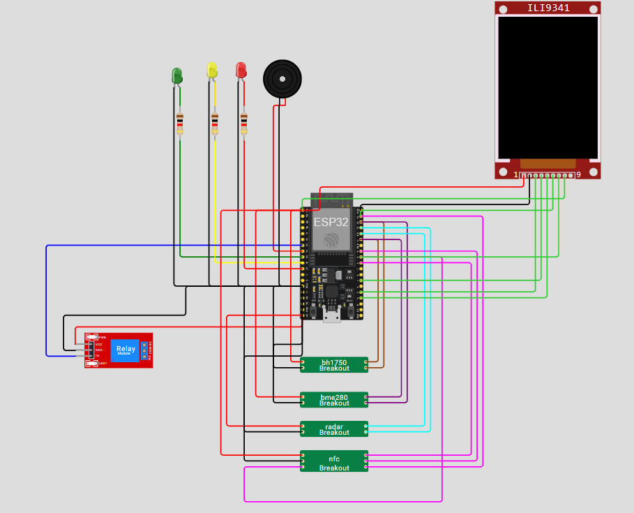

# Control de Asistencia y Monitorización de Aulas (IoT)

  


Repositorio con el backend en Python (Flask + WebSockets) y el código para dispositivos ESP32 que permiten:
- Registrar asistencia vía NFC.
- Monitorizar temperatura, iluminación y presencia en aulas.
- Control remoto de relés por aula.
Este README recoge: estructura del repo, cómo configurar y ejecutar el backend, y notas útiles para trabajar con el firmware.

## Estructura principal
- `Database/` — Dump SQL: `backupControlAsistencia.sql` con el esquema / datos de ejemplo.
- `Device/` — Sketches y código C++ para ESP32 (PN532, sensores, lógica de envío):
  - `api_rest.ino`, `leerNFC.ino`, `SensorTempPresNFCMultithyRegistroLimpio.ino`, `webSocketEvent.ino`, `funciones_auxiliares.ino`, `inicializacionsensores.ino`, `pinesyvariablesauxiliares.h`, `UNIT_PN532.*`.
- `Server/` — Backend Python (Flask + WebSockets):
  - `appV4.py` — servidor principal (endpoints REST y arranque de WebSocket server).
  - `config.py` — configuración (DB, SECRET_KEY).
- `README.md` — (este fichero)
- `Sensor para Aula.docx` — documentación adicional.

## Requisitos (backend)
- Python 3.10+ (3.11/3.12 recomendadas).
- MySQL/MariaDB para la base de datos.
- Entorno de Arduino/PlatformIO con soporte ESP32 y las librerías para PN532, BME280, BH1750 si se usa el firmware.

He añadido un `requirements.txt` básico con las dependencias del backend.
## Instalación rápida (Windows / PowerShell)

1) Crear y activar un entorno virtual:
```powershell
python -m venv .venv
.\.venv\Scripts\Activate.ps1
```

2) Instalar dependencias:

```powershell
pip install --upgrade pip
pip install -r requirements.txt
```

3) Importar la base de datos (desde un cliente MySQL):

```powershell
# Ajusta usuario/host y la ruta al .sql según tu entorno
mysql -u root -p control_asistencia < Database\backupControlAsistencia.sql
```

## Configuración

- Edita `Server/config.py` y pon las credenciales correctas en `DB_CONFIG` y una `SECRET_KEY` segura para JWT.
- Evita dejar credenciales en texto plano en repositorios públicos.

Ejemplo (no dejar como está en producción):

```py
DB_CONFIG = {
   'host': 'localhost',
   'user': 'tu_usuario',
   'password': 'tu_password',
   'database': 'control_asistencia',
   'port': 3306,
}

SECRET_KEY = 'CAMBIA_POR_UNA_CLAVE_LARGA_Y_SECRETA'
```

## Ejecutar el backend (desarrollo)

Desde la raíz del repositorio (PowerShell, con el venv activado):

```powershell
python Server\appV4.py
```

- Flask por defecto escucha en: http://0.0.0.0:5000
- El servidor WebSocket usa el puerto: 5678 (ajustable en `appV4.py`).

Notas: `appV4.py` arranca un bucle asyncio para websockets y ejecuta Flask en paralelo. Revisa la variable `loop` en `if __name__ == '__main__'`.

## Endpoints útiles

- GET `/` — Página inicial (render `index.html`).
- POST `/login` — Login de usuario. Devuelve JWT.
- POST `/login_aula` — Login de aula (genera token para el dispositivo/aula).
- POST `/registro` — Registrar asistencia desde ESP32. Body JSON: { "uid": "...", "nombre_aula": "Aula 101" }.
- POST `/datos_aula` — Telemetría periódica del ESP32: { "aula": "Aula 101", "temperatura": 23.5, "luz": 300, "personas": 2, "clase_en_curso": true }.
- POST `/control_relay` — Cambiar relé: { "aula": "Aula 101", "relay": true }.
- GET `/estado_aulas` — Estado en memoria de las aulas.

## WebSockets

- El backend mantiene `connected_clients` y difunde eventos (estado inicial, actualizaciones de aula y de relay) en JSON.
- Puerto por defecto: 5678.

## Revisión rápida del proyecto — hallazgos y recomendaciones

He revisado `Server/appV4.py`, `Server/config.py` y la estructura de `Device/` y `Database/`. Puntos relevantes:

1. Seguridad / buenas prácticas
  - Las contraseñas parecen compararse en texto plano en `/login` y en `/login_aula`. Se recomienda usar hashing (bcrypt/argon2) y verificar con funciones seguras.
  - `Server/config.py` contiene credenciales y `SECRET_KEY` por defecto; no subir estas claves a repositorios públicos.

2. Errores y detalles en `appV4.py` (posibles bugs a corregir):
  - En `registrar_asistencia()` se realizan varias llamadas a `cursor.fetchone()` que parecen fuera de orden; después de obtener `usuario` y luego ejecutar otra consulta, el código hace `profesor = cursor.fetchone()` sin una nueva `execute` previa — esto probablemente devuelve `None` y es innecesario.
  - `logging.debug("Recibido UID válido", uid)` usa firma de logging incorrecta; debería usar `logging.debug("Recibido UID válido: %s", uid)` o f-strings.
  - Validación de `uid` solo comprueba longitud y existencia; conviene validar formato y normalizar inputs.
  - `appV4.py` usa la variable `loop` en varias rutinas; asegúrate que `loop` esté definida antes de cualquier llamada que la use.

3. Experiencia de desarrollador
  - No existe `requirements.txt` (ahora añadido). Considera añadir un `README` separado para firmware con pasos de compilación y librerías necesarias.
  - Añadir `env.example` o usar variables de entorno para evitar poner secretos en `config.py`.


## propuesta refactorización del BACKEND

```
Server/
├── app.py                 # Punto de entrada principal
├── config.py             # Configuración (ya existe)
├── database.py           # Conexión DB (ya existe)
├── requirements.txt      # Dependencias
├── routes/
│   ├── __init__.py
│   ├── auth.py          # Login, JWT
│   ├── asistencias.py   # Registro y consulta asistencias
│   ├── aulas.py         # Datos de aulas, control relay
│   └── dashboard.py     # Rutas de templates
├── services/
│   ├── __init__.py
│   ├── auth_service.py  # Lógica de autenticación
│   ├── asistencia_service.py # Lógica de asistencias
│   └── aula_service.py  # Lógica de estado de aulas
├── websockets/
│   ├── __init__.py
│   ├── ws_server.py     # Servidor WebSocket
│   └── ws_handlers.py   # Manejadores de eventos WS
├── models/
│   ├── __init__.py
│   ├── usuario.py       # Modelo Usuario
│   ├── aula.py         # Modelo Aula
│   └── asistencia.py   # Modelo Asistencia
├── utils/
│   ├── __init__.py
│   └── decorators.py   # Decoradores personalizados
└── templates/           # Ya existe
    └── static/          # Ya existe
```